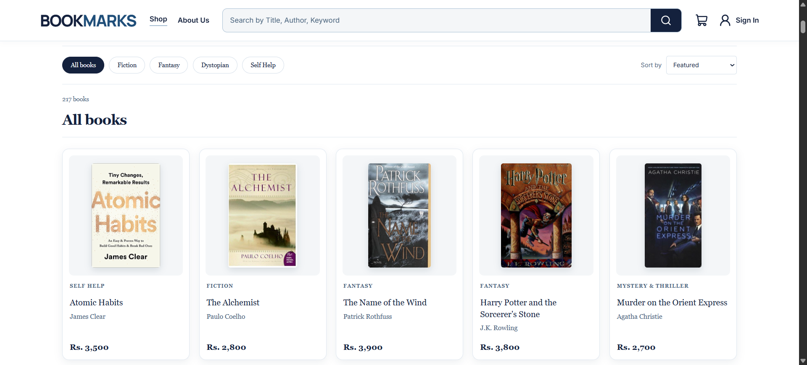
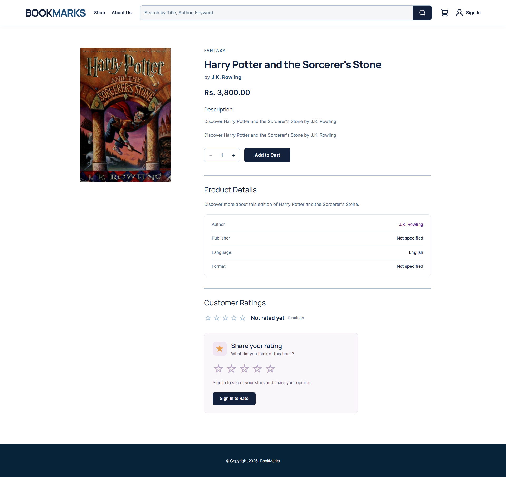
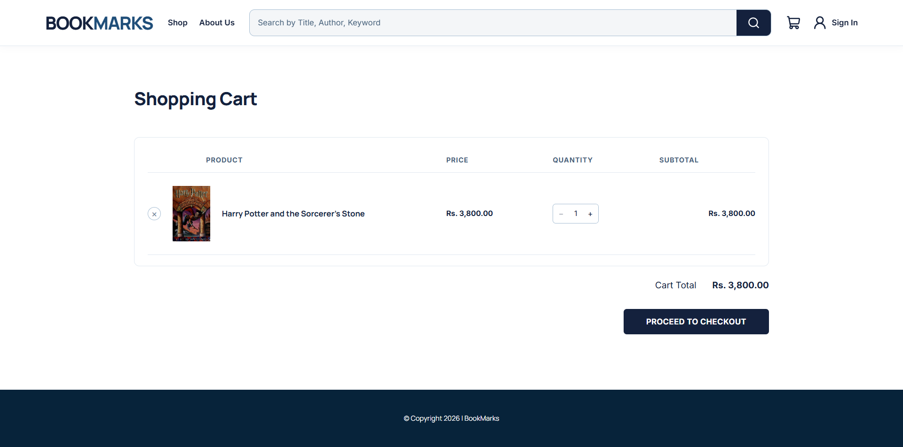

# 📚 BookMarks — Online Bookstore

BookMarks is a full-stack online bookstore application designed to provide a seamless book shopping experience. The platform includes a customer-facing website and an administrative dashboard for managing bookstore operations.

## Features

### Customer
- Browse and search books by title, author, or keyword.
- View book details, author profiles, and ratings.
- Register, log in, and reset passwords.
- Add books to the shopping cart and place orders.
- View order history and order status.
- Receive email notifications for order updates.

### Administrator
- Dashboard with sales analytics and statistics.
- Manage books, prices, and stock availability.
- Add and edit author profiles and photographs.
- Manage customer information.
- View and update orders.
- Monitor inventory and restock books.

## Technology Stack

| Frontend | Backend | Database |
|---|---|---|
| React.js, Vite, CSS3 | Node.js, Express.js | PostgreSQL |

**Additional Technologies:** React Router, Recharts, Lucide React, Nodemailer, Multer.

## Screenshots

### Customer Interface

**Homepage**


**Book Catalog**



**Book Details**



**Shopping Cart**




## Installation

**1. Clone the repository**

```bash
git clone https://github.com/daveasda/BookMarks.git
cd BookMarks
```

**2. Install dependencies**

```bash
cd backend
npm install

cd ../frontend
npm install
```

**3. Configure environment variables**

Configure the PostgreSQL database connection, authentication settings, email credentials, and frontend/backend URLs in the appropriate `.env` files.

**4. Run the backend**

```bash
cd backend
npm run dev
```

**5. Run the frontend in a separate terminal**

```bash
cd frontend
npm run dev
```

Open `http://localhost:5173` to access the application.

## Project Structure

```text
BookMarks/
├── frontend/       # React frontend
├── backend/        # Node.js and Express API
├── screenshots/    # Application screenshots
└── README.md
```


© 2026 BookMarks. All rights reserved.
